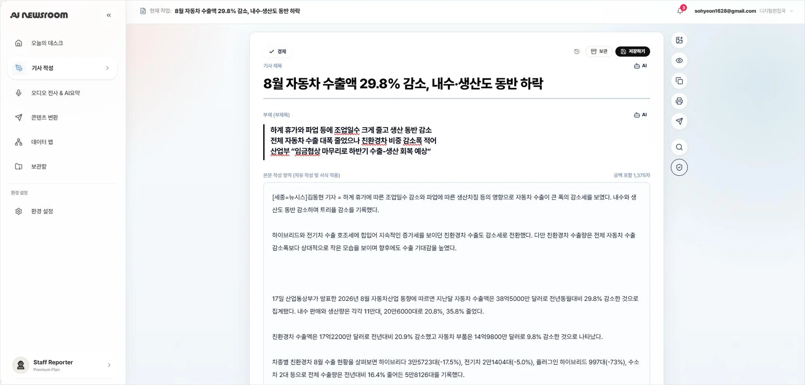
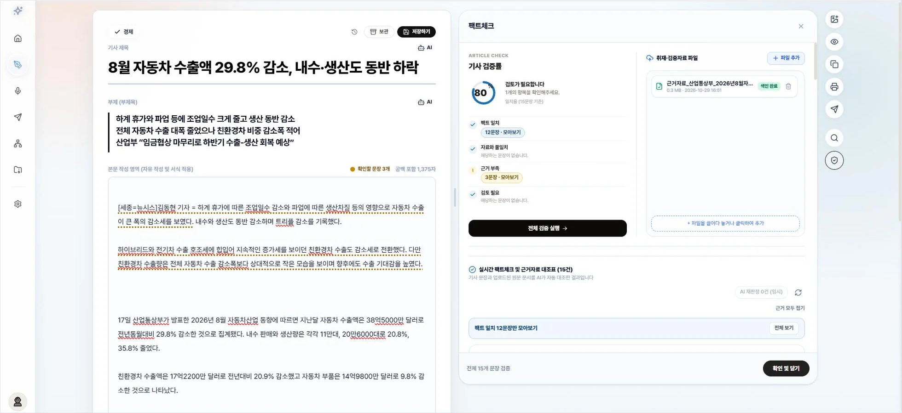
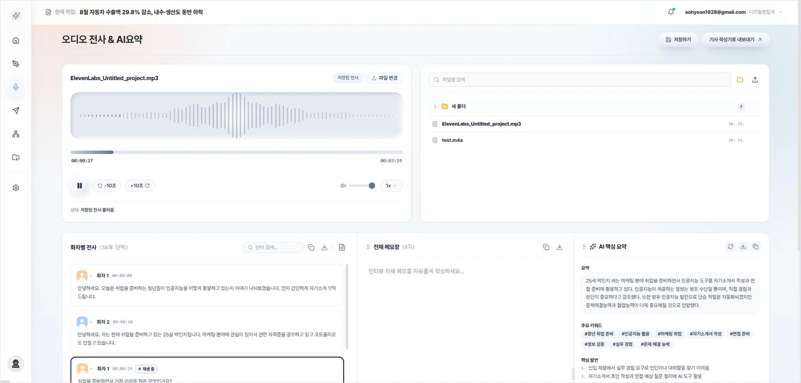
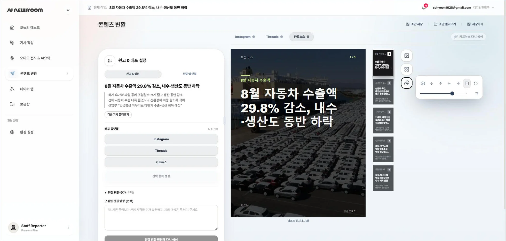
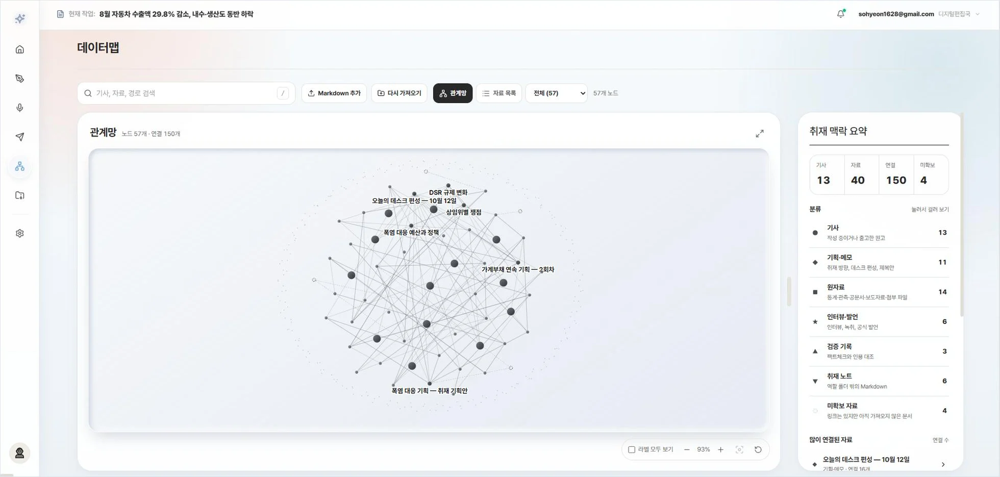
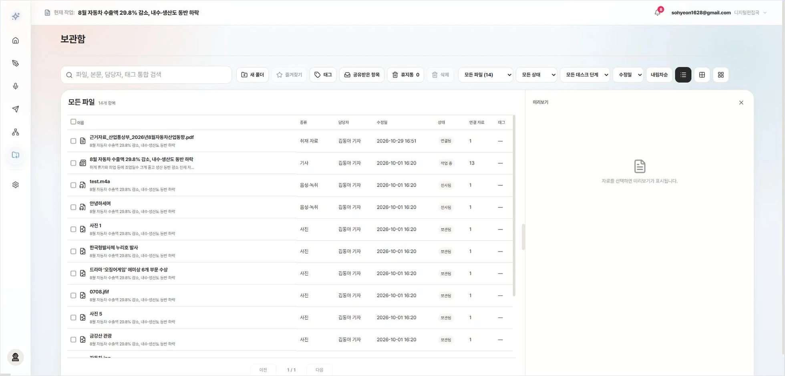

# AI Newsroom OS


기사 한 건이 발행되기까지 기자가 오가는 프로그램을 하나의 작업 공간으로 묶은 **로컬 설치형 뉴스룸 앱**입니다.
취재자료·녹취·팩트체크·기사 작성·플랫폼 변환·보관을 **기사 ID 하나**로 연결하고, 원고는 내 PC의 암호화 저장소(SQLCipher)에 둡니다.

## Screenshots

| 기사 작성 | 팩트체크 |
|---|---|
|  |  |
| **오디오 전사 & AI 요약** | **콘텐츠 변환 (카드뉴스)** |
|  |  |
| **데이터맵** | **보관함** |
|  |  |

## Features

- **오늘의 데스크** — 상태별 기사 건수, 지금 집중할 기사, 확인할 것, 마감 큐
- **기사 작성** — 제목·부제·본문 직접 작성 + AI 제안, 사진 검색·출처 표기, 사진 편집(비율·모자이크)
- **팩트체크** — 본문에서 확인할 문장을 뽑고, 등록한 근거자료에서 근거를 찾아 문장별로 판정
  - 의미 검색(DenseFly) + 키워드 검색(BM25)을 순위 융합(RRF)해 판정기로 보낼 후보를 좁힘
- **인터뷰·녹취** — NAVER CLOVA Speech 장문 전사, 화자별 편집·메모·폴더, 발언을 기사로 보내기
- **콘텐츠 변환** — 원고를 불변 고정본으로 얼린 뒤 Instagram·Threads·카드뉴스 원고 생성, 원문 근거 검수, 카드 렌더
- **데이터맵** — 기사·자료·Markdown 파일의 링크·백링크·미해결 링크를 관계망으로 탐색
- **보관함** — 원고·송고본 구분, 통합 검색·필터·미리보기, 휴지통 복구, 기사 공유(owner·viewer·importer 권한)
- **환경 설정** — 로컬 AI 모델(ONNX) 설치, 사용자 자료 암호화 백업·복구
- **저장** — 자동 저장(작업본 1칸)·수동 저장(새 리비전)·송고(CMS 성공 시에만 기록)를 분리

## Tech Stack

**Frontend (`src/`):** React 19.2, Vite 8.3, Tailwind CSS 4, lucide-react, Pele (Mermaid → SVG), @ssabrojs/hwpxjs, oxlint

**Desktop · Local Core (`article_editor/`):** Python 3.10+, pywebview + WebView2, SQLCipher (스키마 v8), keyring, ONNX Runtime (DirectML), KeT5·KoBART (제목·부제), pypdf·pdfplumber·olefile, PyInstaller, Playwright

**Platform Generator (`platform-generator/`):** Node.js (CommonJS), Express 5, openai SDK, jsdom, @mozilla/readability, Playwright

**Remote Proxy (`backend/`):** Python 표준 라이브러리만 사용, Render 배포

**External Services:** OpenAI, NAVER CLOVA Speech, Cloudflare Workers AI, Supabase (Auth·Postgres·Storage), Unsplash, CMS 송고 API

## Architecture

```text
src/ (React UI)
   │  HTTP(개발) 또는 IPC(배포)        src/api/
   ▼
article_editor/app/core (Python 코어, SQLCipher 로컬 DB, 기본 포트 8765)
   │                        │
   ▼                        ▼
platform-generator/     backend/ + Supabase
(플랫폼 변환)            (외부 AI 중계·인증·공유·사진·클라우드 백업)
```

화면은 Core API 하나만 부르고, 외부 AI와 CMS는 반드시 인증된 원격 프록시를 거칩니다. 프론트(웹뷰)는 로그인 토큰을 알지 못하며 Core 메모리에만 둡니다.

## Run Locally

Python과 Node.js가 필요합니다.

**Windows 데스크톱 창으로 실행** — 최신 UI를 빌드하고 창을 엽니다. 의존성은 배치 파일이 프로젝트 로컬에 설치합니다.

```powershell
git clone https://github.com/beang66/ai-newsroom-os.git
cd ai-newsroom-os
.\article_editor\start_window_fresh.bat
```

**브라우저 개발 모드** — 터미널 두 개를 사용합니다.

```powershell
# 터미널 1: 코어 API (기본 포트 8765)
cmd /c article_editor\scripts\ensure_storage_deps.bat
py -3 .\article_editor\app\server.py
```

```powershell
# 터미널 2: 메인 UI
npm ci
npm run dev
```

브라우저에서 http://127.0.0.1:5173 을 엽니다. `npm run build` 결과는 `article_editor/app/frontend/`에 생성되며 Python 코어와 EXE 패키징이 같은 결과를 사용합니다.

**플랫폼 변환기(개발용 카드 편집실)**

```powershell
cd platform-generator
npm ci
npm start   # http://localhost:3001
```

## Environment Variables

**프론트 (`.env`, `.env.example` 참고)**

| 변수 | 설명 |
|---|---|
| `VITE_DATA_MAP_MODE` | `demo`(로컬 UI 확인) 또는 `api`(Core 연동) |
| `VITE_WORKSPACE_ID` | 작업공간 ID (연동 시 Core 세션에서 받음) |
| `VITE_CORE_BASE_URL` | 비우면 같은 출처 `/v1` 사용 |
| `VITE_GA_TRACKING_ID` | GA4 측정 ID (분석 동의 후에만 전송) |

**원격 프록시 (`backend/`, Render 환경 변수)** — 비밀값은 이 서버에만 두고 앱이나 저장소에 넣지 않습니다.

| 변수 | 설명 |
|---|---|
| `OPENAI_API_KEY` | 텍스트 생성·임베딩 |
| `CLOVA_SPEECH_INVOKE_URL`, `CLOVA_SPEECH_SECRET_KEY` | 녹취 전사 |
| `CF_ACCOUNT_ID`, `CF_API_TOKEN` | Cloudflare Workers AI |
| `SUPABASE_URL`, `SUPABASE_ANON_KEY` | 인증(JWT 검증) |
| `UNSPLASH_ACCESS_KEY` | 사진 검색 |
| `ALLOWED_EMAILS` | 프록시 사용 허용 계정 |
| `CMS_PUBLISH_URL`, `CMS_BEARER_TOKEN`, `CMS_ALLOWED_EMAILS` | CMS 송고 |
| `BACKUP_MASTER_KEY` | 공유·백업 키 파생 |

나머지 선택 변수(`RATE_LIMIT_PER_MIN`, `CLOVA_RATE_PER_MIN` 등)는 [backend/README.md](backend/README.md)를 참고하세요.

## Running Tests

```powershell
npm test                                   # UI·API 계약 회귀
npm run build
npm test --prefix platform-generator       # 플랫폼 변환기
$env:PYTHONPATH = "$pwd\article_editor\.runtime"
npm --prefix article_editor run test:python  # Python 코어
npm run test:ui                            # 화면 테스트 (Edge + 가짜 백엔드 + 임시 저장소)
```

## Deployment

- **원격 프록시**: [render.yaml](render.yaml) Blueprint로 Render에 배포합니다. Render → New → Blueprint → 이 저장소를 선택하고 비밀값만 입력합니다.
- **Supabase**: `article_editor/integration/`의 SQL 스크립트(`supabase_setup.sql`, `supabase_article_shares.sql`, `supabase_transfer_bucket.sql`)를 SQL Editor에서 한 번 실행합니다. 모두 기존 객체를 지우지 않는 추가형입니다.
- **Windows EXE**: PyInstaller로 패키징합니다. [article_editor/packaging/README.md](article_editor/packaging/README.md)를 참고하세요.

## Documentation

- [저장 설계](docs/STORAGE_DESIGN.md)
- [백엔드 프록시](backend/README.md)
- [EXE 패키징](article_editor/packaging/README.md)
- [시스템 구조·ERD·API·OpenAPI](docs/architecture/)

## Authors

**Team Finally**

| 이름 | 역할 | 담당 |
|---|---|---|
| 안정빈 | Product / Integration | 제품·데이터 설계, 데스크·데이터맵·보관함·접근 권한 |
| 강창희 | App Core / AI | 앱 통합, 팩트체크, 계정·보안·백업 |
| 박소현 | UI/UX / Transcript | 전체 화면 UI/UX, STT·녹취 |
| 고서연 | Authoring / Media | 기사 작성·저장·송고, 제목·부제, 사진 |
| 이정민 | Distribution | 플랫폼 원고·카드뉴스, 검수, Renderer |
